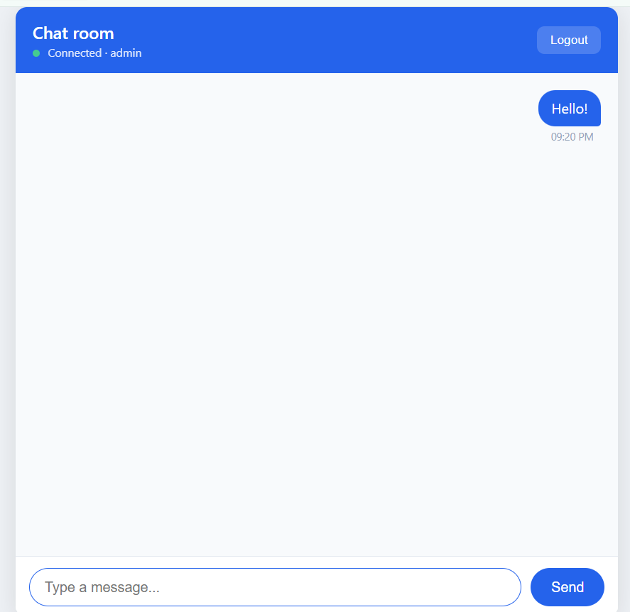

# Chat App

A real-time chat application built with Django, Django Channels, and Daphne. Users can sign up, log in, and chat live over WebSockets.

## Features

- User signup, login, and logout (Django's built-in auth)
- Real-time messaging with WebSockets
- Protected chat page (login required)
- Styled chat UI with message bubbles, timestamps, and connection status
- One-click startup on Windows with `run.bat`

## Tech Stack

- Python 3.10+
- Django
- Django Channels
- Daphne (ASGI server)
- SQLite (default database)

## Project Structure

```
chatapp/
├── manage.py
├── run.bat
├── README.md
├── requirements.txt
├── chatapp/
│   ├── settings.py
│   ├── urls.py
│   ├── asgi.py
│   └── wsgi.py
└── chat/
    ├── consumers.py        # WebSocket consumer
    ├── routing.py          # WebSocket URL routes
    ├── urls.py             # HTTP URL routes
    ├── views.py            # signup and chat views
    └── templates/
        ├── chat/
        │   └── chat.html
        └── registration/
            ├── login.html
            └── signup.html
```

## Setup

### 1. Create and activate a virtual environment

```bash
python -m venv venv
venv\Scripts\activate
```

On macOS/Linux: `source venv/bin/activate`

### 2. Install dependencies

```bash
pip install django channels daphne
```

Or, if `requirements.txt` exists:

```bash
pip install -r requirements.txt
```

To create or update it:

```bash
pip freeze > requirements.txt
```

### 3. Apply migrations

```bash
python manage.py migrate
```

### 4. Run the server

```bash
python manage.py runserver
```

Open http://127.0.0.1:8000/ in your browser.

## Quick Start on Windows

Double-click **`run.bat`**. It activates the virtual environment, applies migrations, opens your browser, and starts the server.

## Usage

1. Go to http://127.0.0.1:8000/signup/ and create an account.
2. You'll be taken to the chat page automatically.
3. To test with multiple users, open a private/incognito window and sign up as a second user.
4. Messages from each user appear instantly on both screens.

## Key Settings

In `chatapp/settings.py`:

```python
INSTALLED_APPS = [
    'daphne',          # must be first
    'django.contrib.admin',
    'django.contrib.auth',
    'django.contrib.contenttypes',
    'django.contrib.sessions',
    'django.contrib.messages',
    'django.contrib.staticfiles',
    'channels',
    'chat',
]

ASGI_APPLICATION = 'chatapp.asgi.application'

CHANNEL_LAYERS = {
    'default': {
        'BACKEND': 'channels.layers.InMemoryChannelLayer',
    }
}

LOGIN_URL = 'login'
LOGIN_REDIRECT_URL = 'chat'
LOGOUT_REDIRECT_URL = 'login'
```

## Routes

| URL            | Purpose                         |
| -------------- | ------------------------------- |
| `/`            | Chat page (login required)      |
| `/login/`      | Login                           |
| `/logout/`     | Logout (POST)                   |
| `/signup/`     | Create an account               |
| `/admin/`      | Django admin                    |
| `ws/chat/`     | WebSocket endpoint              |

## Optional: Admin Access

```bash
python manage.py createsuperuser
```

Then visit http://127.0.0.1:8000/admin/.

## Troubleshooting

| Problem | Fix |
| --- | --- |
| `No module named 'django'` | Activate the venv and use `python`, not `python3` |
| `No module named 'daphne'` | Run `pip install daphne` |
| `You have not set ASGI_APPLICATION` | Add `ASGI_APPLICATION = 'chatapp.asgi.application'` to `settings.py` |
| `SyntaxError` in `settings.py` | Check for missing quotes or stray commas |
| Messages don't appear | Check the browser console (F12) and the terminal for WebSocket errors |
| Rocket page instead of the app | Make sure `chat` is in `INSTALLED_APPS` and `chat.urls` is included in `chatapp/urls.py` |

## Limitations

- Messages are not saved. They disappear on page refresh.
- The in-memory channel layer works only with a single process. Use Redis (`channels_redis`) for production.
- `DEBUG = True` and the default `SECRET_KEY` are for development only.

## Roadmap

- [ ] Save messages to the database and load history
- [ ] Multiple chat rooms
- [ ] Redis channel layer for deployment
- [ ] Online users list and typing indicator

## License

Free to use and modify for learning and personal projects.

